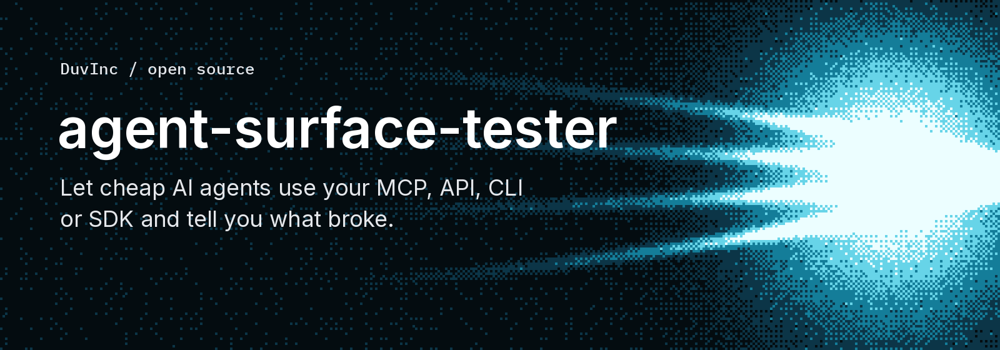

# agent-surface-tester



**You built an MCP server, a REST API, a CLI or an SDK for agents. Have you watched an agent use them?**

This runs a cheap AI agent that has never seen your product, gives it **one door** (your MCP tools, your REST API and its documentation, your command line, or your client SDK), a plain mission and a hard budget, and writes down what it did and what it thought: what was obvious, what it had to guess, what broke, what it expected to work differently. The agent is the user your tool descriptions, your OpenAPI file, your `--help` and your type definitions were written for.

```bash
cp targets/example.json targets/my-server.json     # URL, how to authenticate, one sentence of context
node --env-file=.env bin/agent-surface-tester.mjs tools --target targets/my-server.json
node --env-file=.env bin/agent-surface-tester.mjs run   --target targets/my-server.json \
  --mission missions/full-tour.md --model openai/gpt-6-luna --flex --max-cost 0.05
# MCP server: my-server 1.0.0, 48 tools
# · get_account {}  (212 ms)
# · add_text_resource {"title":"mcp-test-notes", ...}  (1619 ms)
# ...
# Cost $0.00441, 52 tool calls, stopped by finished
# Report: reports/2026-11-01-11-57-02_mcp_full-tour_openai-gpt-6-luna.md
```

The report has a score out of 10, what worked, friction with a severity, missing behaviour, coverage, unclear descriptions and "what would make it a 10". Next to it sits the trace of every call, with duration, outcome, and the coverage the harness measured itself (how many distinct tools, operations, commands or methods were actually used).

## Four doors, one agent each

| Door | What the agent gets | How it learns the product |
| :--- | :--- | :--- |
| `mcp` | The tools the server lists, as they are, annotations included | The tool descriptions, which is all a model has |
| `api` | `http_request` (base URL fixed, credential added by the harness) and `read_docs` (GET on the doc hosts you list, in windows of 12,000 characters) | `llms.txt`, the OpenAPI file, your guides: it has to find its way, as a real agent does |
| `cli` | `run_cli` (an argument array, no shell), `write_file` and `read_file` in a scratch folder | `--help`, the output of the tool, its error messages |
| `sdk` | `run_code` (Node.js ESM in a scratch folder with your package linked), `read_docs`, `write_file`, `read_file` | Exported methods, `.d.ts` declarations, README and guides |

One door per run, on purpose. An agent that can reach the MCP, the API, the CLI and the SDK at once mixes them and you learn about none. Run the same mission on each door to see where agents sail through and where they guess wrong.

## About the cost: what testing an agent surface costs

Automated agent testing is accessible enough to run before every release. On OpenRouter or compatible gateways, a comprehensive 20 to 50 step product tour typically costs between a fraction of a cent and a few pennies, depending on the model tier and the protocol.

| Model tier | Typical tour cost | Role in your testing loop |
| :--- | :--- | :--- |
| **Fast models on flex tiers** (e.g. Gemini Flash, GPT-6 Luna) | **$0.005 to $0.03** | Frequent sweeps, regression tests, catching raw documentation holes, missing payload examples, and unhandled 500 crashes. |
| **Frontier reasoning models** (e.g. GPT-6.1 Terra, Claude Sonnet) | **$0.01 to $0.05** | Stress-testing complex boundary conditions (such as quantity limits or edge-case allergen policies), parallel calls, and clean-up verification. |
| **Free community models** (`:free` suffix) | **$0.00** | Adding model diversity across open weights at zero cost. |

Two things decide the real bill more than the model's list price:

- **Prompt caching.** Most providers cache the repeated prefix on their own. Anthropic models only cache when asked, so the harness marks the system prompt and the newest message for them (`lib/cache.mjs`); without it, every step of a long run paid full price for the whole transcript.
- **Context-size pricing.** Some models charge more per token past a size (Claude Haiku 5.5: five times more above 100k prompt tokens). The transcript only grows, so cap it with `--max-prompt-tokens`.

Protocol differences also change the token economics:

- **MCP servers** hand the full tool schema catalogue to the agent on every turn. If your server exposes 40 or more tools, prompt tokens add up quickly.
- **CLIs and REST APIs** give the agent a compact initial surface (3 basic harness tools) and let the agent query `--help` or `llms.txt` only when needed, often cutting token usage by half or more for the same task.

Running the same mission across all doors surfaces discrepancies that unit tests cannot see: an empty input returning a clean 400 validation error on REST while triggering an unhandled 500 on MCP, an undocumented parameter name guessed wrong by multiple independent models, or a plan cap reported as an unavailable feature rather than a quantity limit.

## How it works

```text
mission.md ──► agent loop ◄──► any tool-calling model (OpenRouter, or any OpenAI-compatible gateway)
                  │
                  ├─ limits per operation, --max-steps, --max-cost                      (hard)
                  ├─ ownership guard: may only change what it created this session      (hard)
                  ├─ one run at a time per workspace (lock keyed on the credential)     (hard)
                  ▼
        door: MCP client │ HTTP tool + docs reader │ CLI in scratch dir │ Node.js SDK runner
                  │
                  └──► report.md + trace.json
```

Decisions, and what was rejected:

- **One agent per run, one neutral system prompt.** The prompt describes the setup and the report format, nothing about your product beyond a sentence you write. A tester that has been told what you worry about finds it.
- **The harness enforces the rules, the prompt informs.** The first free model tested renamed and paused an object it had not created, in spite of "only change what you created" in its instructions. `lib/ownership.mjs` remembers the ids that creating operations returned and refuses any mutating call that names an id it does not know. On HTTP, CLI and SDK the same guard checks paths, arguments and script source (on SDK, treat that as a rail against a mistaken model rather than a sandbox against hostile code). The harness also injects the credential itself, so the model never sees it.
- **One agent per workspace.** Two agents in the same workspace read each other's objects, rename them and delete them, and the feedback becomes about the collision. `lib/lock.mjs` refuses a second run on a credential that is already in use (a crashed run does not block anyone: a lock whose process is gone is taken over). To test several doors at once, give each its own workspace and its own key: `suite` runs them in parallel and queues runs that share a workspace.
- **The CLI and SDK are isolated from the inside out.** Commands and scripts run in a fresh temp directory deleted at the end, with scrubbed environments, output caps and execution timeouts. For untrusted code, run inside a container.
- **Clean workspace, every run.** A run starts and ends by deleting what carries the test prefix. Without it, agents found a previous agent's leftovers, could not tell whose they were, and refused to touch them.
- **Cheap models, several of them.** A full tour is about 300k input tokens. On a small model on the flex tier that is half a cent. Free models cost nothing and add diversity. One model's opinion is a hypothesis; the same point from three models is a signal.
- **Zero npm dependencies.** Built on Node 22 standard modules (`node:fs`, `node:child_process`, `node:test`, native `fetch`). Everything runs on your machine; it needs a model key and a credential for the product, nothing else.

## Feedback is input, not a verdict

Treat every report as one user's view.

- Models disagree. In real runs, one claimed a response lacked a field that another had just logged. Verify a claim against the server before acting on it.
- Models flatter. Scores of 7 to 9 out of 10 came with real defects named inside. Read the friction list, not the score.
- Weak models misread the harness as the server's fault. The prompt says not to; some do anyway.
- What your product should do is your decision. Four agents asked for a blocking `--wait` flag on a CLI whose rule is one HTTP request per command; we kept the rule and clarified the status output instead.

## Try it locally

```bash
git clone https://github.com/DuvInc/agent-surface-tester && cd agent-surface-tester
npm test                      # no network, no key: fake servers and a fake model gateway on localhost
cp .env.example .env          # OPENROUTER_API_KEY, and the credential of the product you test
```

Without a key, `npm test` still runs the whole loop across all four doors against fakes.

## Giving the agent a credential

An agent needs a credential to use your product, and building browser signup automation is a distraction from testing the interface itself. Five simple ways cover almost every setup:

1. **An environment variable.** Create a scoped test API key, set it in `.env`, and point `"auth": { "type": "bearer", "env": "MY_SERVER_API_KEY" }` at it. The harness adds the header or child variable; the model never sees the token.
2. **A local disposable sandbox.** Start your product locally (Docker, Miniflare, SQLite) and seed three or four empty workspaces with test keys in SQL. Agents can create, break and delete things at zero cost and zero risk to real data.
3. **A setup script that mints and revokes a key.** If your backend has an admin CLI or migration script, wrap the run in a short shell script that creates a temporary workspace key before `suite` and deletes it right after.
4. **Clipboard hand-off (`--key-from-clipboard`).** Copy a fresh key from your dashboard and pass `--key-from-clipboard` for a one-off run without writing the token to disk.
5. **An OAuth helper.** If your server only speaks OAuth, complete the login once yourself (or exchange a refresh token in a local script) and pass the short-lived access token through an environment variable.

## Putting it in your product

1. **A sandbox workspace per door.** Create a separate workspace (or run a local instance) for each interface you test, with its own test credential, narrow scopes and a small credit balance. Nothing real in it. Revoke production keys when you are done.
2. **A target file per door** (`targets/example.json`, `example-api.json`, `example-cli.json`, `example-sdk.json`): `surface`, how to authenticate, a `context` sentence, `rules`, `limits` on everything that spends money or imports from the internet, `ownership` rules that say which operations create things, and a `cleanup` section.
3. **Missions** are plain Markdown with `{{surface}}` filled in: `first-use`, `full-tour`, `edge-cases` (errors), `docs-vs-reality` (every claim in the documentation checked against the product), `boundaries` (what the credential may and may not do, and how clearly it says so). A prompt you gave to a chat assistant makes a good mission as it is.
4. **A suite** (`suites/example.json`) lists runs: target, mission, model, budget. `agent-surface-tester suite --suite suites/my.json` runs them, in parallel across workspaces.
5. **After a crashed run**, `cleanup` deletes everything whose name starts with `cleanup.prefix` (default `mcp-test-`), through an MCP endpoint of the same workspace.

The model contract, if you want another provider, is one function: `chat(body, { flex })` in `lib/openrouter.mjs`, which takes an OpenAI-style chat-completions body with `tools` and returns `{ message, usage, cost, tier }`. Any OpenAI-compatible gateway works with `LLM_BASE_URL` and `LLM_API_KEY`; cost reporting and the flex tier are OpenRouter features.

If you use a coding agent, [skills/agent-surface-tester](skills/agent-surface-tester/SKILL.md) is the procedure written for it.

## What this is not

- **Not a test suite.** It finds what an agent finds confusing, not whether your server returns the right bytes. Keep your own tests.
- **Not a benchmark.** Runs on one product say nothing about how models rank in general.
- **Not safe on real data.** The guard stops a mistaken model from changing what it did not create. It does not stop it from reading, and it does not make an admin key safe to hand over.
- **Not OAuth, not browsers, not stdio servers.** Remote MCP servers over HTTP, REST over HTTPS, local command line tools, and Node.js client SDKs.
- **Not an attack tool.** The `boundaries` mission checks that refusals are clear. It does not try to get around anything.
- **Not a judge of your product.** Agents tell you how it feels to use. Whether to change it is yours to decide.

## Credits

Models through [OpenRouter](https://openrouter.ai). MIT licence. See [CONTRIBUTING.md](CONTRIBUTING.md) and [AGENTS.md](AGENTS.md).
